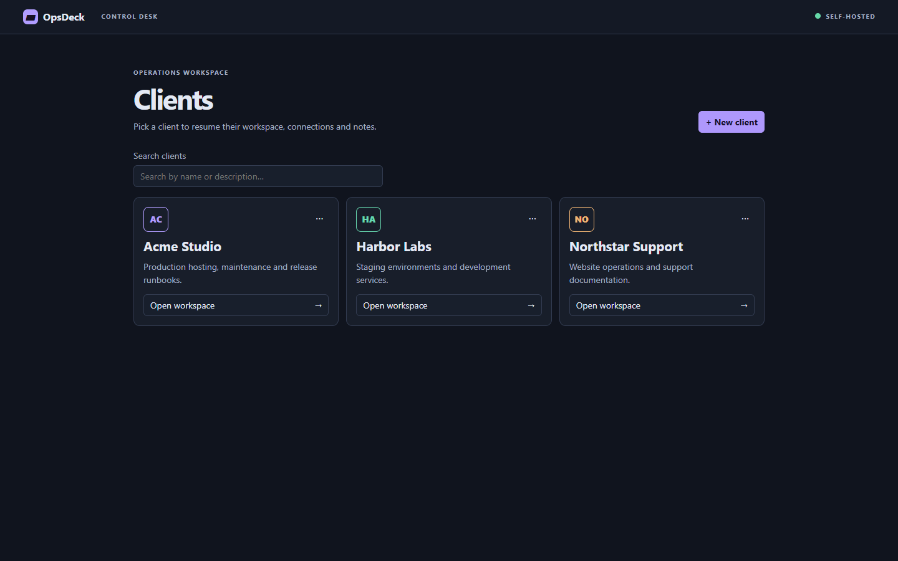
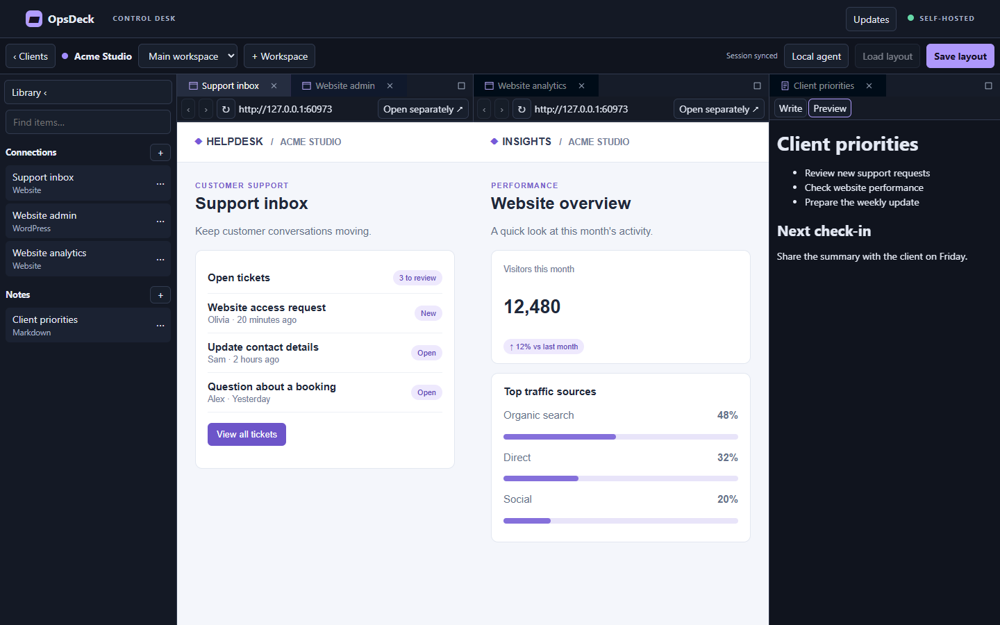
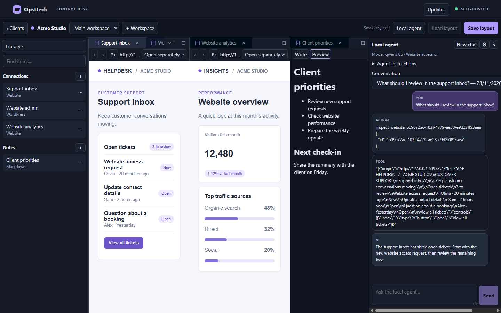
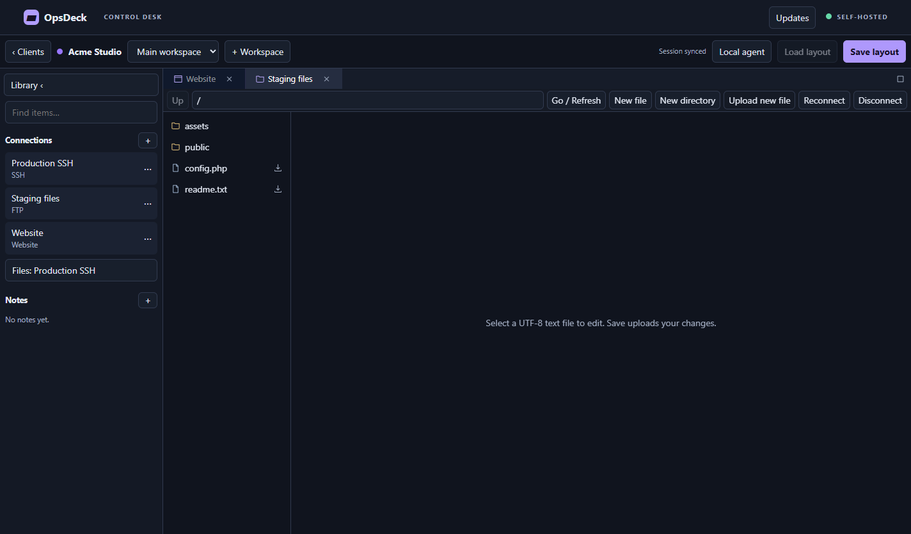
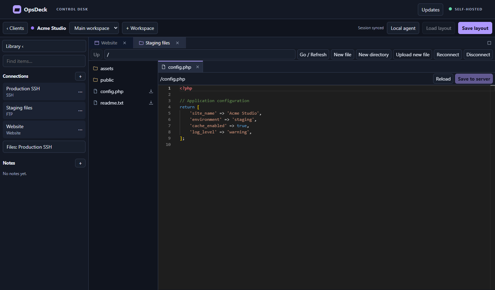
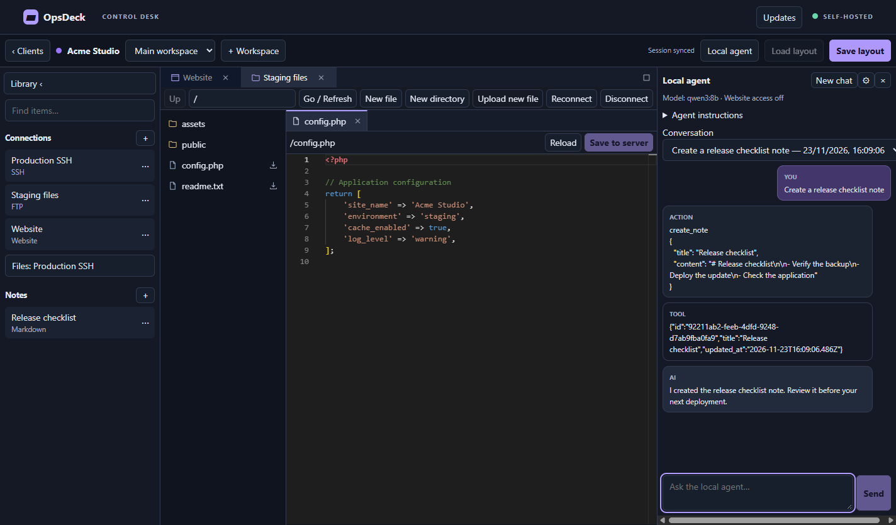

# OpsDeck

**Every client. Every tool. One organized workspace.** OpsDeck brings the websites, conversations and notes you use for each client together, so you can get to work without hunting through a sea of browser tabs.

Keep a support inbox next to a website dashboard, a WordPress admin panel, analytics and your client notes. Switch clients to switch context, arrange tabs and panes the way you like, and return to your saved workspace later. Whether you manage websites, projects or technical operations, OpsDeck helps keep the relevant information close at hand.

OpsDeck works without AI or a model download. When you want a hand, its optional **local AI assistant** can help organize the workspace and work with notes, files and terminals. With website access enabled for the session, it can also inspect visible pages and interact with supported controls. Review its actions: it can make real changes and can make mistakes.

OpsDeck is a single-operator desktop application, not a multi-user access-control system.

## A clearer way to work across clients

Start with a client list rather than a pile of unrelated browser tabs. Open a workspace to bring that client's connections and notes together; use named workspaces and saved layouts to organize different tasks or projects.

| Client dashboard | Client workspace |
| --- | --- |
|  |  |

### Your websites, side by side

Keep support tickets, web front ends, WordPress admin, analytics such as Google Analytics and notes within the same client workspace. Open multiple website panes, drag tabs to arrange or split them, and keep the context you need in view. Each client's website profile is separate, so its cookies and sessions are kept apart from other clients.



### An assistant that can help in context

Ask the local assistant to help with the workspace you're already using. For example, with website access enabled, it can read visible support-page text and interact with supported controls; it can also work with notes and other connected tools. Website access is off by default, does not cover every site or iframe, and is not visual screenshot understanding. Check its actions and outputs before relying on them.



### Tools for technical work, too

| Remote file browser | Monaco editor |
| --- | --- |
|  |  |



Screenshots use demonstration data. The example websites and assistant responses are scripted; browser-pane captures are assembled with the desktop workspace capture.

## What you can do

- **Organize clients:** keep connections and notes together, search the library, and use named workspaces and reusable layouts.
- **Stay on top of web work:** keep support, website administration, analytics and notes organized by client, with website panes side by side.
- **Bring tools together:** open websites, SSH terminals, notes and remote file editors side by side; drag tabs to dock, split and reorder them.
- **Work with remote files:** browse SFTP, FTPS and FTP, create files and directories, upload or download files, and edit text in Monaco, the editor engine used by VS Code.
- **Keep a runbook nearby:** write Markdown notes with preview and autosave.
- **Use an optional local assistant:** ask it to open panes, work on notes and files, and help with connected terminals. Conversations can be reopened and continued.

## Get started

### Portable desktop app

Download a ZIP from [GitHub Releases](https://github.com/Davidalanfisk/OpsDeck/releases) for **Windows x64** or **macOS Apple silicon**. Extract it to a writable folder and launch `OpsDeck.exe` on Windows or `OpsDeck.app` on macOS. Keep the Windows executable with its extracted support files. No system installer or Node.js installation is required.

The builds are not vendor-signed or notarized. Windows SmartScreen or macOS Gatekeeper may warn or block them, especially on managed devices. Only run software you trust and that your device policy permits.

1. Create a client and open its **Main workspace**, or create a named workspace.
2. Use **+** beside Connections or Notes to add an item, then open it from the library.
3. Drag tabs to arrange your workspace. **Save layout** and **Load layout** manage named layouts; the most recent session is saved separately.
4. Optionally open **Local agent** to set up the assistant. The rest of OpsDeck does not require it.

Desktop data is stored per user, outside the extracted app: `~/Library/Application Support/OpsDeck/workspace` on macOS and `%APPDATA%\OpsDeck\workspace` on Windows. Keep a backup of this data.

### Build and run the desktop app from source

Install [Node.js 24 LTS](https://nodejs.org/en/download), then from the cloned or extracted source directory:

```sh
npm ci
npm run build:desktop
npm run start:desktop
```

On Windows, use `npm.cmd` if PowerShell blocks the npm script shim. To build a portable desktop ZIP, run `npm run package:desktop`.

## Websites and sessions

Desktop website connections open in docked, top-level Chromium panes rather than iframes. Sign-in popups and cookies use a persistent profile shared by a client's panes, separate from other clients and from Chrome. Some sites or passkey flows still require the system browser; use **Open separately** if needed. OpsDeck does not bypass certificate checks or site login policies.

Recent tabs resume while OpsDeck is running. Cookies, website storage and cache for a client are cleared after 30 days without open website panes, on the next launch or an hourly check; sites can expire sessions sooner. Tab-only state can be lost when the app quits or frees an idle tab. OpsDeck does not provide Chrome's password manager or load arbitrary Chrome extensions; use your regular browser and its password manager when needed.

## SSH and remote files

Add an SSH connection with the host, port, username and a **trusted SHA256 server host-key fingerprint**, obtained independently from the server administrator or console. Choose password or SSH agent authentication. Your computer must be able to reach the remote host. Restarting OpsDeck restores the terminal pane, not the live shell or scrollback; reconnect, or use a remote multiplexer for a persistent shell.

If your hosting provider only gives you an address, port and login (as in GoDaddy's SSH setup), enter those details and choose **Check server key**. Compare the displayed fingerprint with the SHA256 host key fingerprint supplied by the provider through a separate trusted channel, then select **I verified it**. The lookup does not send your password, and the presented key is not proof of the server's identity by itself. If you cannot verify it, ask your provider; do not approve an unknown or changed key. Enter the SSH password when connecting.

For agent authentication, load your existing key in the terminal that starts OpsDeck:

```sh
echo "$SSH_AUTH_SOCK"
ssh-add ~/.ssh/id_ed25519
ssh-add -l -E sha256
```

Replace the example key path with your private key. `ssh-add` prompts for its passphrase; OpsDeck does not store it. Select the corresponding **agent identity fingerprint** in the connection form: it is different from the server host-key fingerprint. If needed, start an agent with `eval "$(ssh-agent -s)"`, load the key and start OpsDeck from that same terminal. A packaged macOS app can be launched from that terminal via its `OpsDeck.app/Contents/MacOS/OpsDeck` executable.

Add an **SFTP**, **FTPS** or **FTP** connection, or open **Files** for an existing SSH connection. SFTP uses SSH authentication and host-key verification. FTPS requires a valid trusted certificate and supports explicit or implicit TLS. **Plain FTP transmits passwords and files unencrypted** and requires acknowledgement on every connection; prefer SFTP or FTPS.

Browse folders, create a **New file** or **New directory**, upload a new file, or download files. Open UTF-8 text files in the docked Monaco editor; syntax highlighting is available for common languages. **Save to server** or `Ctrl+S` / `Cmd+S` uploads the active draft. Remote saves check the original revision and refuse detected conflicts, retaining the draft. This is optimistic conflict detection, not a lock: concurrent creates can race with the final rename. Keep backups of production files.

Text editing is limited to 1 MiB and transfers to 10 MiB per file; symbolic links are not opened. UTF-8 BOMs and normal LF/CRLF endings are preserved, though Monaco may normalize mixed endings. The server must allow temporary-file creation and rename. File sessions expire after 15 idle minutes; reconnect retains open drafts and revisions. Drafts are not persisted across quitting, and discarding dirty tabs, layouts or workspaces prompts for confirmation.

### Saved connection passwords

Passwords are **not saved by default**. You can opt in to secure storage after successful authentication. Encryption uses Windows DPAPI, macOS Keychain or a supported Linux secret service; Linux's basic-text fallback is rejected. Windows protects against other users but not necessarily other applications running as the same user.

An SSH connection shares its saved password between the terminal and Files browser; either form can forget it. Changing connection identity or authentication settings prevents reuse of the old saved password. SSH-agent connections do not use saved passwords. Saved credentials do not make plain FTP encrypted.

## Local AI assistant

The desktop assistant uses a locally running Ollama service with cloud features disabled. Open **Local agent**, select a model, choose **Set up local model**, then read and acknowledge the warning. OpsDeck downloads a pinned Ollama runtime and verifies its SHA-256 checksum, then downloads the model. The runtime needs roughly 230 MB on Apple silicon or 1.6 GB on Windows x64, plus extraction space and 2.5–19 GB for the selected model. The 30B model can exceed the available memory on a 24 GB machine; GPU availability and free memory affect performance. Downloads require internet access, and local processes may be able to access the loopback service.

The assistant can list and open panes, create website connections and notes, read and edit notes and remote files, and read terminal output or send single-line commands. Connections must already be opened and authenticated by you. Tool actions, results and errors are shown in the conversation. Enter sends; Shift+Enter adds a line.

Open files are read with their unsaved editor content; assistant edits appear in the draft and require **Save to server** to upload. Open notes update in the editor and use normal autosave. Changes made after the assistant reads a draft are detected and rejected; read it again before retrying. Closed-file edits upload immediately using a matching revision. Agent edits are exact, unique text replacements checked against the latest read, so large files (up to the 1 MiB text limit) can be edited without sending the whole file to the model; whole-file replacement is only allowed for small files read completely. Terminal output does not prove a command finished. Review recovered note drafts before choosing **Save recovered draft**.

**The assistant can execute commands and modify files or notes without further approval.** It can be misled by untrusted content, and **Stop** cannot undo an action already sent. Use trusted systems, backups and careful review. If the app closes during an action, inspect the target before retrying: the action may already have completed.

Website access is **off by default** and must be enabled for each agent session. When enabled, the assistant can read visible page text and interact with numbered controls; this is not visual screenshot understanding and does not cover every site or iframe. Common password and one-time-code fields are filtered, but detection is not guaranteed. Logged-in content may be visible to the model.

Conversations are saved per client in SQLite, including prompts, tool arguments and results. **They are not encrypted by OpsDeck** and can contain sensitive data. Use **New chat** and the conversation selector to reopen or continue them. Failed saves and concurrent edits are reported rather than silently overwritten.

The assistant defaults to a 32,768-token context. In agent settings, choose 8K, 16K, 32K, 64K or 128K, up to the loaded model's reported maximum; the preference is saved per client. If a model supports less than the saved preference, OpsDeck shows and uses the largest supported choice. Larger windows need more RAM/VRAM and may be slower or fail to load. OpsDeck reserves space for responses; actual available context depends on the runtime. **Context diagnostics** shows estimated current usage, the requested and reported loaded sizes when available, payload sizes, and token counts reported by Ollama after a request. Diagnostic logs contain counts and sizes, not prompt contents. Estimates are approximate, not a guarantee against context errors. When the estimated budget reaches the configurable threshold in agent settings, older complete turns are summarized automatically; **Compact conversation** can do this manually. The full conversation remains saved and visible, but summaries may omit details or be inaccurate. Very large individual turns may still require a new chat or shorter input.

Use **Client project memory** in agent settings to explicitly save or remove facts shared with the assistant for that client. This memory is stored locally without encryption and sent to the model with requests; do not put passwords or secrets in it. For code and long notes the assistant works search-first: it searches one connected remote file or its open draft for several literal terms at once (for example `tree|animate|requestAnimationFrame`), or requests a file outline with line counts, 150-line chunk ranges and a lightweight symbol index (functions, classes, methods, HTML IDs, CSS selectors, exports and Markdown headings). It then loads only a matching symbol or line range of up to 150 lines and roughly 8,000 characters, edits it, and receives the edited lines back for checking. Small files are returned complete; large files are never loaded whole by default. Earlier tool results and large tool-call arguments are shortened in the model's context while the full trace stays in the saved conversation, where long entries are collapsed. Symbol detection uses simple pattern matching, so it can miss or misidentify code in unusual formatting; searches are literal and cover one file at a time. Normal revision and draft conflict checks apply. There is no vector search or semantic project-wide indexing yet.

For source installs, `npm run setup:ollama` can prepare the runtime and default model from a terminal; `npm run setup:ollama -- qwen3:8b` selects a model. Start the model from the desktop assistant afterward. Image generation is not currently built in.

## Updates

**Portable Windows x64 and macOS Apple silicon builds:** version 0.6.3 or later can check for updates. In **Updates**, choose **Download verified update**, then **Show downloaded ZIP**. Save remote drafts, extract the ZIP to a new folder, close OpsDeck and launch the new copy. Keep the old copy until the new one works; portable installs do not automatically install or roll back. Earlier portable versions require a one-time manual installation of an updater-capable version. User data is shared between copies, but OS credential access may prompt or require re-entry. Back up before updating, especially before downgrading.

**macOS Apple silicon source installs:** launch the first updater-capable build with `npm run start:desktop`. Under **Updates**, choose **Download and build update**, then **Restart and install**. The app preserves a Node/npm runtime and builds in a separate version directory; the previous version is restored if the new one fails its startup check. Save remote drafts first: restarting disconnects sessions and interrupts agent actions. For future launches use `~/Library/Application Support/OpsDeck/source-updates/OpsDeck.command` or the original source launcher. Startup checks do not verify every feature.

Both update paths verify SHA-256 checksums against the public [update feed](https://github.com/Davidalanfisk/OpsDeck-updates). Checksums detect corruption but are **not publisher signatures**; trust the feed, release assets and their maintainers. Source updates execute downloaded code and dependency scripts as your user. In-app updates are limited to the platforms described above.

## Development and releases

Use Node.js 24 LTS. `npm run build` type-checks and builds the frontend; `npm test` runs tests with local fixtures and requires `ssh-agent`, `ssh-add`, `ssh-keygen` and `openssl` on PATH.

After `npm run build:desktop`, `npm run test:desktop` exercises the desktop workspace and requires a working graphical display. `npm run test:desktop:portable` exercises the updater dialog and desktop bridge with fixture downloads; it does not install a ZIP. `npm run package:desktop` creates a portable ZIP in `release/`. The desktop backend listens on loopback port `43139` and accepts requests only from its trusted workspace browser session.

To publish an update, build and test both portable artifacts from the same reviewed commit. Create a `v<version>` GitHub Release with `OpsDeck-<version>-mac-arm64.zip` and `OpsDeck-<version>-win-x64.zip`, and place those ZIPs in local `release/`. Run `npm run package:source-update -- <commit-or-tag>` and `npm run package:portable-feed`. The source package includes only allowlisted tracked files, not local data, `.env`, dependencies or profiles. Publish both generated source packages under `packages/` in `Davidalanfisk/OpsDeck-updates`, verify all public downloads and checksums, and publish the generated `latest.json` **last**. Source and portable artifacts must describe the same version.
