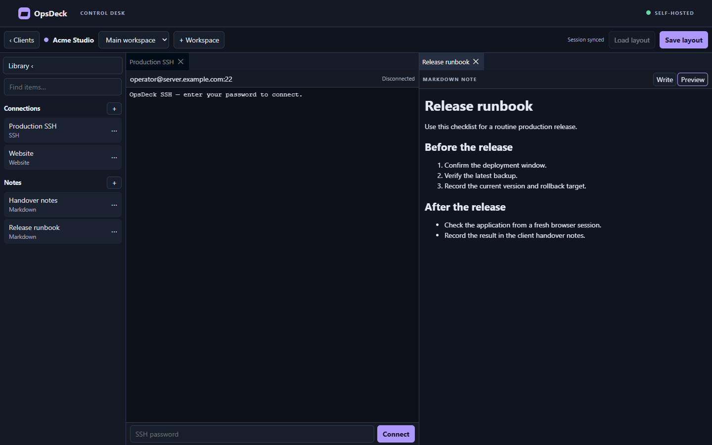

# OpsDeck

OpsDeck is a self-hosted, single-operator workspace for client operations. Keep SSH terminals, Markdown runbooks and web tools together in dockable windows.

## Screenshots

| Client dashboard | Docked workspace |
|---|---|
|  |  |

Screenshots use demo data.

## Install with Docker Compose (recommended)

Install Docker for your platform and start its engine:

| Platform | Prerequisites |
|---|---|
| Windows | Install [Docker Desktop for Windows](https://docs.docker.com/desktop/setup/install/windows-install/) with the WSL 2 backend. Start Docker Desktop and run the commands below in PowerShell. |
| macOS | Install [Docker Desktop for Mac](https://docs.docker.com/desktop/setup/install/mac-install/), choosing the Apple silicon or Intel download for your Mac. Start Docker Desktop and run the commands below in Terminal. |
| Linux | Install [Docker Engine](https://docs.docker.com/engine/install/) and the [Docker Compose plugin](https://docs.docker.com/compose/install/linux/) for your distribution. Run the commands below as a user with access to the Docker daemon. |

Download and extract the source archive from [GitHub Releases](https://github.com/Davidalanfisk/OpsDeck/releases), or clone the `v0.1.0` release with Git:

```sh
git clone --branch v0.1.0 https://github.com/Davidalanfisk/OpsDeck.git OpsDeck
cd OpsDeck
```

From the folder containing `docker-compose.yml`, run:

```sh
docker compose version
docker compose up --build -d
```

Open [http://127.0.0.1:3000](http://127.0.0.1:3000). If the app does not open, check `docker compose logs opsdeck`. Compose stores SQLite in the `workspace` named volume. `docker compose down` stops the app and keeps the data; `docker compose down -v` deletes it.

To override the published port or other settings, create a `.env` file next to `docker-compose.yml` (one `KEY=value` entry per line), then rerun `docker compose up -d`.

| Compose setting | Default | Purpose |
|---|---|---|
| `OPSDECK_BIND` | `127.0.0.1` | Host address to publish on |
| `OPSDECK_PORT` | `3000` | Published port |
| `OPSDECK_ORIGIN` | Same as the request host | Explicit public origin, e.g. `https://opsdeck.example.com`, if a reverse proxy rewrites the host |

**Keep this MVP private.** OpsDeck has no login or multi-user permissions. Anyone who can reach it can read and modify client data and initiate SSH connections from the server. Keep the loopback binding, or put it behind an authenticated HTTPS reverse proxy or other trusted access boundary with WebSocket forwarding. Only configure SSH endpoints you administer or are authorized to access, and limit container network access to the hosts you need.

## Install without Docker

Install [Node.js 24 LTS](https://nodejs.org/en/download) for your platform: use the Windows or macOS installer, or the Linux download or a version manager that provides Node 24. Check `node --version` in a new terminal; it should report `v24.x`. From the extracted source or cloned repository, run these commands in order:

```sh
npm ci
npm run build
npm start
```

Open [http://127.0.0.1:3000](http://127.0.0.1:3000). The server runs in the foreground; press `Ctrl+C` to stop it. SQLite data stays in `data/opsdeck.sqlite`, and restarting the server with `npm start` reuses it. If PowerShell blocks the npm script shim on Windows, use `npm.cmd` in place of `npm`.

## Use the workspace

1. Create a client and open its **Main workspace**, or create a named workspace.
2. Use **+** beside Connections or Notes to add items. Click a library item to open it as a window. The library search matches note titles and content.
3. Drag tabs to split, dock or reorder them. Drag split dividers to resize. **Save layout** stores a named workspace's reusable layout; **Load layout** reapplies it. The most recent session is saved separately and reopened automatically in the same browser.
4. For SSH, enter the connection's host, port, username, and a trusted SHA256 host-key fingerprint. Obtain that fingerprint from the server administrator or console (for example, run `ssh-keygen -lf /etc/ssh/ssh_host_ed25519_key.pub` on the server for its Ed25519 host key). The **OpsDeck server/container**, not your browser, must be able to reach the SSH host. Enter the password in the terminal window; it is never saved.

Browser restart restores the terminal window, not the live SSH process or scrollback. Reconnect with the password; use a remote multiplexer if the shell itself needs to survive a disconnect. Sites that block embedding or require full browser storage can be opened via **Open separately**.

## Develop

Use Node.js 24 LTS on Windows, Linux or macOS.

```sh
npm ci
npm run dev:api
```

In another terminal, run `npm run dev` and open [http://localhost:5173](http://localhost:5173). `npm run build` type-checks and builds the frontend; `npm start` serves it with the API. `npm test` runs the SQLite and SSH integration tests using local fixtures. For direct Node runs, use `HOST`, `PORT` and `DATA_DIR` to override the defaults (`127.0.0.1`, `3000`, `data`).

Window implementations are registered in `src/panels.tsx`. Dockview layouts reference stored item IDs, while SQLite, the JSON API and the SSH transport remain separate from the window renderer.
